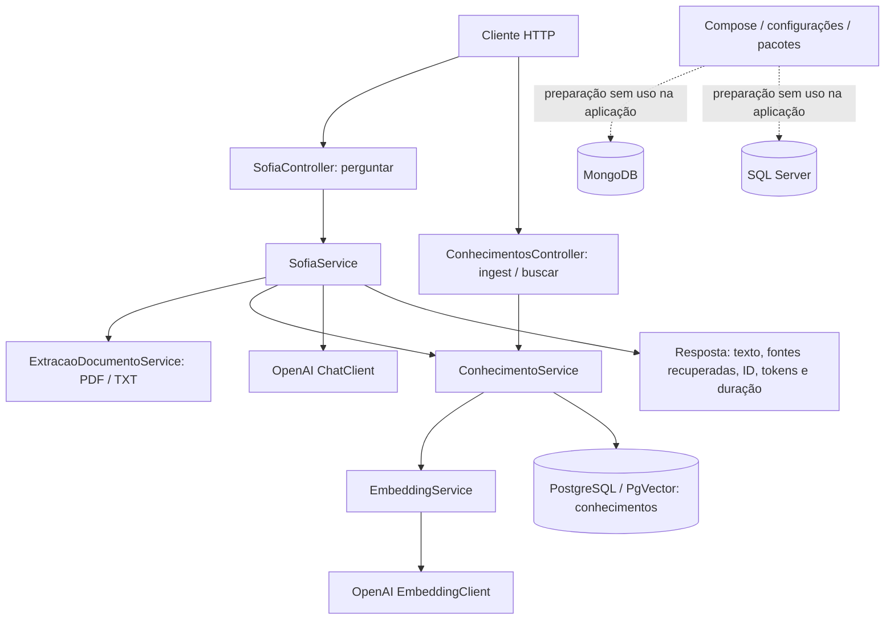

# SOFIA INFIS — análise da solução .NET e lacunas para integração A2A

Data: 05/11/2026. Escopo: arquivos presentes na pasta da solução `SofiaInfis`.

## 1. Resultado executivo e critérios

A solução contém uma API ASP.NET Core em .NET 10, com perguntas respondidas diretamente pelo SDK da OpenAI, recuperação semântica de conhecimentos no PostgreSQL/PgVector e extração de texto de anexos PDF/TXT. O fluxo implementado é sequencial e atende uma requisição por vez dentro de cada execução.

Embora SOFIA seja descrita no prompt e no Swagger como agente orquestrador, **não existe orquestração de agentes especializados no código atual**. Microsoft Agent Framework, A2A, MongoDB e OpenTelemetry aparecem em dependências ou configurações, mas não estão integrados ao fluxo de aplicação. A memória conversacional não está implementada. O rastreamento limita-se a metadados retornados na resposta e logs de erro/validação.

Critérios usados neste relatório:

- **Implementada:** há código executável conectado ao fluxo da aplicação. Não significa funcionamento comprovado em ambiente real.
- **Parcialmente implementada:** existe uma parte funcional ou preparação de infraestrutura, mas faltam elementos para a capacidade completa.
- **Não implementada:** não há implementação encontrada nos arquivos analisados; pacote, comentário, descrição ou configuração isolada não comprova a funcionalidade.

Foi realizada análise estática de todos os 15 arquivos C# da aplicação, da solução, do projeto, das configurações, do Docker Compose, do perfil de execução e do arquivo HTTP. Diretórios `bin`, `obj` e `.vs` não foram tratados como código-fonte. Os diretórios `.agents`, `.github/skills` e `.specify` contêm recursos de processo/especificação, não componentes do runtime SOFIA.

Não foram executados build, restore, testes, containers, migrações, chamadas à OpenAI ou consultas aos bancos. A disponibilidade dos serviços, a validade das credenciais, o esquema existente em bancos externos e a compatibilidade efetiva dos pacotes não foram verificadas. Nenhum código-fonte, configuração ou dependência foi alterado; o único artefato criado nesta etapa é este relatório. A pasta analisada não possui repositório Git reconhecido pelo comando `git status`.

## 2. Projetos e organização

| Artefato | Conteúdo e responsabilidade |
|---|---|
| `SofiaInfis.slnx` | Solução com apenas um projeto e referência ao `docker-compose.yml` como item de solução. |
| `SofiaInfis.Api/SofiaInfis.Api.csproj` | Projeto `Microsoft.NET.Sdk.Web`, `net10.0`, nullable e implicit usings habilitados. |
| `Program.cs` | Composição da API, OpenAPI, Swagger, clientes OpenAI, serviços e mapeamento dos controllers. |
| `Controllers/` | Dois controllers; três operações HTTP de negócio. |
| `Services/` | Quatro serviços concretos para perguntas, conhecimentos, embeddings e extração. |
| `DTOs/` | Cinco records de entrada/saída. |
| `Extensions/` | Três extensões para DI, clientes OpenAI e Swagger. |
| `Properties/launchSettings.json` | Perfil local HTTP em `http://localhost:5151`, ambiente Development, abertura do Swagger. |
| `SofiaInfis.Api.http` | Exemplo residual de `GET /weatherforecast/`; não corresponde a um endpoint implementado. |
| `SofiaInfis.Api.csproj.user` | Preferências de scaffolding da IDE; não adiciona funcionalidade de negócio. |

A arquitetura é uma aplicação única com separação por pastas. Não há projetos separados de domínio, infraestrutura, contratos compartilhados, agentes especializados ou testes. Também não há camada de repositórios/interfaces próprias: os serviços concretos são injetados diretamente, e `ConhecimentoService` acessa o PostgreSQL.

## 3. Arquitetura e fluxo existentes

### 3.1 Inicialização

`Program.cs:3–17` registra controllers, OpenAPI, Swagger, clientes OpenAI e os serviços de aplicação. Depois disponibiliza OpenAPI/Swagger, chama `UseAuthorization()` e mapeia os controllers.

`DependencyInjectionExtension.cs:9–12` registra os quatro serviços como **scoped**. `OpenAiClientConfigExtension.cs:20–28` registra `EmbeddingClient` e `ChatClient` como **singleton**, lendo modelos e chave da configuração.

Não há registro/uso de autenticação JWT, políticas próprias de autorização, clientes A2A, agentes do framework, MongoClient ou instrumentação OpenTelemetry. `UseAuthorization()` e o esquema Bearer descrito no Swagger não estabelecem autenticação dos endpoints.

### 3.2 Perguntas à SOFIA

Fluxo de `SofiaService.PerguntarAsync` (`Services/SofiaService.cs:14–271`):

1. Inicia `Stopwatch` e gera `Guid` para a execução.
2. Valida no máximo cinco arquivos, extrai o texto e monta um bloco por arquivo, preservando o nome como metadado com `Path.GetFileName`.
3. Busca sempre os três conhecimentos semanticamente mais próximos da pergunta, usando embedding apenas da pergunta.
4. Monta contexto com título, origem, similaridade e texto dos resultados.
5. Monta um prompt de sistema fiscal/tributário/contábil e uma mensagem do usuário com pergunta, anexos e conhecimentos.
6. Executa `ChatClient.CompleteChatAsync` diretamente, sem ferramentas nem delegação.
7. Concatena conteúdos textuais e devolve tokens do chat, duração, ID e metadados.

São enviadas apenas duas mensagens: sistema e usuário. Não são carregadas mensagens anteriores. A instrução do prompt para considerar o contexto da conversa não é acompanhada de memória implementada.

O prompt orienta escopo INFIS, resposta em português, até 150 palavras por padrão, uso de evidências, recusa de assuntos externos, proteção de dados de clientes e tratamento de documentos como dados. Essas são instruções ao modelo; não há validação determinística da resposta para garantir escopo, anonimização, fontes ou contagem de palavras.

### 3.3 Ingestão e recuperação RAG

`ConhecimentoService` implementa:

- Divisão de texto por **caracteres**, em blocos de 1.200 com sobreposição de 200 (`:23–59`). Não é divisão por tokens nem por estrutura documental.
- Geração sequencial de embedding para cada bloco antes de abrir a transação SQL (`:83–103`).
- Validação de 1.536 dimensões e conversão do vetor para representação textual com cultura invariável (`:61–69`, `:95–97`).
- Inserção parametrizada com Dapper/Npgsql e `CAST(@Embedding AS vector)` na tabela `conhecimentos`, com transação, commit e rollback (`:105–175`).
- Busca parametrizada por distância cosseno com `<=>`, ordenação crescente de distância e similaridade calculada por `1 - distância`, limitada por `TopK`, entre 1 e 20 (`:179–237`).

A tabela esperada possui `id`, `titulo`, `texto`, `fonte`, `indice_chunk` e `embedding`. **Não foram encontrados scripts SQL, migrações, criação da extensão `vector`, DDL da tabela ou criação de índices vetoriais.** A imagem Docker contém PgVector, mas o provisionamento da extensão e do esquema no banco não está demonstrado pelo repositório. A dimensão é exigida no código; o tipo efetivo da coluna no banco não foi inspecionado.

O campo `DocumentoReferencia` da ingestão recebe o ID do primeiro chunk. Os demais chunks recebem GUIDs independentes; não há `documento_id` comum gravado pelo SQL. Isso limita agrupamento, atualização e remoção de todos os chunks de um documento.

A busca não aplica limiar mínimo de similaridade, filtros de cliente/tenant, reranking ou busca híbrida. Os anexos de uma pergunta **não são automaticamente ingeridos** na base vetorial: seus textos entram apenas no prompt daquela requisição. A ingestão persistente aceita texto via JSON.

## 4. Controllers e contratos HTTP

| Controller / operação | Entrada | Saída de sucesso | Validações e erros |
|---|---|---|---|
| `SofiaController` — `POST /api/v1/sofia/perguntar` | `multipart/form-data`, `PerguntaSofiaRequest` | `200`, `RespostaSofia` | Pergunta obrigatória; anotações do DTO; limite HTTP/form de 20 MiB; erros de argumento/documento tratados com 400; erro geral com 500; cancelamento do cliente é relançado. |
| `ConhecimentosController` — `POST /api/v1/conhecimentos/ingest` | JSON, `IngestConhecimentoRequest` | `200`, objeto com `Mensagem`, `DocumentoReferencia`, `Titulo`, `Fonte`, `TotalChunks` (nomes JSON sujeitos à política padrão do ASP.NET) | Anotações do DTO e campos não vazios no serviço; `ArgumentException` vira 400; demais exceções viram 500. |
| `ConhecimentosController` — `POST /api/v1/conhecimentos/buscar` | JSON, `BuscarConhecimentoRequest` | `200`, coleção de `ConhecimentoResultado` | Pergunta obrigatória e `TopK` entre 1 e 20; 400 para argumentos inválidos, 500 para demais exceções. |

Os controllers usam `[ApiController]`, permitindo validação automática de model binding/DataAnnotations. Os erros tratados manualmente retornam objeto com `mensagem`; não há contrato único próprio de erro para todas as origens, nem middleware global customizado de exceções.

Documentação técnica: `MapOpenApi()` é chamado sem restrição a Development; Swagger JSON e UI também são habilitados sem condição de ambiente. A UI fica em `/swagger`, com documento `v1`. Scalar está referenciado, mas não mapeado.

### DTOs identificados

| Record | Campos e restrições |
|---|---|
| `PerguntaSofiaRequest` | `pergunta`: obrigatória, 5–2.000 caracteres; `arquivos`: lista opcional de `IFormFile`. Limites de quantidade/tamanho são aplicados fora do DTO. |
| `RespostaSofia` | `idExecucao`, `pergunta`, `resposta`, `arquivosProcessados`, `conhecimentosUtilizados`, `tokensEntrada`, `tokensSaida`, `tokensTotal`, `duracaoMs`. |
| `IngestConhecimentoRequest` | `titulo`: obrigatório, 5–200; `texto`: obrigatório, 20–100.000; `fonte`: obrigatória, 3–500 caracteres. |
| `BuscarConhecimentoRequest` | `Pergunta`: obrigatória, 5–2.000 caracteres; `TopK`: padrão 3, intervalo 1–20. |
| `ConhecimentoResultado` | `id`, `titulo`, `texto`, `fonte`, `IndiceChunk`, `Similaridade`. |

Não há DTOs de conversa, usuário, tenant, histórico, custo, catálogo de agentes, delegação, tarefas A2A, mensagens A2A ou artefatos de especialistas.

## 5. Serviços e integrações

| Serviço | Responsabilidade implementada | Integração efetiva |
|---|---|---|
| `SofiaService` | Coordena extração, RAG, prompt, chamada ao chat e montagem da resposta. | Serviços locais e `OpenAI.Chat.ChatClient`. |
| `ConhecimentoService` | Chunking, persistência de conhecimentos e busca vetorial. | Dapper, Npgsql e `EmbeddingService`. |
| `EmbeddingService` | Rejeita texto vazio, chama `GenerateEmbeddingAsync`, retorna `float[]`. | `OpenAI.Embeddings.EmbeddingClient`. |
| `ExtracaoDocumentoService` | Valida anexos e extrai texto de PDF/TXT. | PdfPig e leitura de stream .NET. |

### Extração documental

`ExtracaoDocumentoService.cs:9–70` restringe cada arquivo a **5 MiB**, aceita extensão `.pdf` ou `.txt`, rejeita vazio e ausência de texto. TXT é lido com UTF-8 estrito e detecção de BOM. PDF é aberto com PdfPig e tem `pagina.Text` concatenado.

O conteúdo retornado é truncado em 20.000 caracteres por arquivo, com marcador `[DOCUMENTO TRUNCADO]`. O truncamento ocorre **após** a extração/leitura integral; não limita antecipadamente o trabalho de parsing. Com cinco anexos, o teto HTTP de 20 MiB continua prevalecendo sobre a soma potencial de cinco arquivos de 5 MiB.

Não há OCR, extração de DOCX/XLSX/imagens, interpretação estruturada de tabelas, armazenamento permanente dos anexos, fila de ingestão ou vínculo persistente entre arquivo e conhecimentos. A validação inicial do formato usa extensão; não há verificação explícita de MIME/assinatura. O parser de PDF pode falhar ao abrir o arquivo. A extração PDF é síncrona e não recebe o token de cancelamento internamente.

### OpenAI

Modelos configurados: chat `gpt-4.1-mini` e embedding `text-embedding-3-small`. São valores do projeto, não uma recomendação de modelos nem validação de disponibilidade. O chat usa diretamente o SDK `OpenAI`, sem `AIAgent`, `IChatClient`, function calling, ferramentas, saída estruturada ou streaming.

Há propagação de `CancellationToken` às chamadas OpenAI e às operações assíncronas SQL/leitura TXT. Não há política própria explícita de timeout, retry, circuit breaker ou fallback; comportamentos internos padrão dos SDKs não foram auditados.

### MongoDB, memória e histórico

MongoDB possui pacote, connection string, nome de banco e serviço Docker. Não há criação de `MongoClient`, coleções, documentos de histórico, repositórios ou operações de leitura/escrita na aplicação. Portanto, infraestrutura MongoDB está parcialmente preparada, mas **persistência de histórico e memória conversacional não estão implementadas**.

Não existe identificador de conversa/sessão na entrada, recuperação de histórico, resumo de memória ou retomada entre requisições. O `idExecucao` é novo a cada pergunta e não representa conversa persistente.

### Rastreamento e custos

São implementados GUID por execução, duração e contagem de tokens **da conclusão de chat**, além de logs de erros/validações nos controllers. O cronômetro cobre o fluxo até a montagem final da resposta, incluindo extração, RAG e chat, mas não serialização/transmissão HTTP.

Não há armazenamento da execução, consulta por ID, registro de etapas, status persistido, correlação entre agentes, spans próprios, configuração de OpenTelemetry ou exportador ativado. Não há relatório de falhas com o mesmo ID devolvido ao cliente. Os pacotes de observabilidade estão apenas declarados.

`OpenAI:Pricing` contém moeda e tarifas configuradas, mas nenhuma rotina lê esses valores para calcular custos. Tokens dos embeddings e custo total do fluxo não são contabilizados. `conhecimentosUtilizados` contém **todos os resultados recuperados**, não uma comprovação de quais fontes o modelo realmente utilizou na resposta.

## 6. Dependências diretas declaradas

Versões abaixo são as de `SofiaInfis.Api.csproj`, sem atualização ou avaliação de compatibilidade por execução.

| Pacote | Versão declarada | Uso encontrado |
|---|---|---|
| Dapper | 2.1.89 | Executa INSERT e consulta de conhecimentos. |
| Microsoft.Agents.AI.A2A | 1.27.0-preview.261030.1 | Apenas referência; nenhuma integração A2A. |
| Microsoft.Agents.AI.OpenAI | 1.27.0 | Apenas referência; nenhum agente do framework criado. |
| Microsoft.AspNetCore.OpenApi | 10.0.9 | `AddOpenApi` / `MapOpenApi`. |
| Microsoft.Data.SqlClient | 7.1.1 | Apenas referência; nenhum acesso ao SQL Server. |
| Microsoft.Extensions.AI | 10.11.0 | Nenhum uso explícito das abstrações na aplicação. |
| MongoDB.Driver | 3.13.0 | Apenas referência; nenhum acesso ao MongoDB. |
| Npgsql | 10.0.3 | Conexões/transações PostgreSQL. |
| OpenAI | 2.14.0 | Chat e embeddings. |
| OpenTelemetry.Exporter.Console | 1.21.0-rc.1 | Apenas referência. |
| OpenTelemetry.Extensions.Hosting | 1.21.0-rc.1 | Apenas referência. |
| OpenTelemetry.Instrumentation.AspNetCore | 1.20.1 | Apenas referência. |
| OpenTelemetry.Instrumentation.Http | 1.20.1 | Apenas referência. |
| PdfPig | 0.1.17-alpha-202611030024-c46d2 | Extração textual de PDF via namespace `UglyToad.PdfPig`. |
| Scalar.AspNetCore | 2.18.7 | Apenas referência; nenhuma UI Scalar mapeada. |
| Swashbuckle.AspNetCore | 10.3.1 | Geração e interface Swagger, esquema Bearer documental. |

Há dependências preview/RC/alpha. A existência delas não demonstra falha; sua compatibilidade e estabilidade precisam de validação antes da implementação A2A. Não foi encontrado pacote PgVector .NET direto: a integração vetorial existente usa SQL e representação textual do vetor.

## 7. Configuração e infraestrutura

| Item | Estado observado |
|---|---|
| PostgreSQL | `ConnectionStrings:PostgreSQL`, host local, porta 5435, banco `bd-sofia-infis`; connection string efetivamente consumida por `ConhecimentoService`. |
| MongoDB | Connection string na porta local 27018 e `MongoDB:DatabaseName` = `bd-sofia-infis-historico`; não consumidos pelo código. |
| SQL Server | Connection string na porta local 1434, banco `bd-sofia-infis`; não consumida pelo código. |
| OpenAI | `ApiKey`, `ChatModel`, `EmbeddingModel` consumidos na criação dos clientes. Chave preenchida com formato de credencial; validade não testada, valor omitido. |
| Tarifas OpenAI | Bloco `Pricing` presente; cálculo de custos ausente. Valores não verificados como preços atuais. |
| Logging | Default Information e Microsoft.AspNetCore Warning, também no arquivo Development. |
| AllowedHosts | `*`. |
| Execução local | HTTP 5151 e Swagger; não há redirecionamento HTTPS configurado no pipeline. |

O Compose define rede bridge, volumes persistentes e healthchecks:

| Serviço | Imagem | Porta host → container | Papel |
|---|---|---|---|
| postgres | `pgvector/pgvector:pg16` | 5435 → 5432 | Infraestrutura da base RAG. |
| pgadmin | `dpage/pgadmin4:9.19` | 5052 → 80 | Administração PostgreSQL; depende de saúde do postgres. |
| mongodb | `mongo:8.0` | 27018 → 27017 | Infraestrutura prevista para histórico. |
| mongo-express | `mongo-express:1.0.2` | 5053 → 8081 | Administração MongoDB; depende de saúde do mongodb. |
| sqlserver | `mcr.microsoft.com/mssql/server:2022-latest` | 1434 → 1433 | Infraestrutura SQL Server sem consumidor na API. |

Não há serviço Docker para a API, Dockerfile, agentes de alunos, coletor de telemetria ou inicialização SQL no Compose analisado. Healthchecks dos containers estão declarados; sua execução não foi verificada. Não há health endpoint da própria API.

As configurações contêm credenciais em texto claro, inclusive chave OpenAI e senhas de bancos/administração. Seus valores não são reproduzidos neste relatório. Antes de compartilhar a solução com alunos, recomenda-se externalizar os segredos e avaliar a rotação das credenciais compartilhadas. Nenhuma alteração foi feita nesta etapa.

## 8. Matriz consolidada de funcionalidades

| Funcionalidade | Classificação | Fundamentação |
|---|---|---|
| API HTTP com controllers e validação básica | Implementada | Três endpoints e DataAnnotations. |
| OpenAPI e Swagger | Implementada | Registro e mapeamento no startup. |
| Pergunta com anexos e resposta OpenAI | Implementada | Pipeline em `SofiaService`. |
| Orientação fiscal/tributária no prompt | Implementada | Prompt de sistema explícito; cumprimento não garantido por validação externa. |
| Geração de embeddings | Implementada | `EmbeddingService` chama o SDK. |
| Ingestão textual com chunking e transação | Implementada | `ConhecimentoService.IngestAsync`. |
| Busca semântica e composição RAG | Implementada | SQL vetorial + inclusão no prompt. |
| Provisionamento reprodutível do RAG | Parcialmente implementada | Compose presente; extensão, tabela e índices sem scripts locais. |
| Extração de documentos | Parcialmente implementada | PDF textual/TXT presentes; OCR e demais formatos ausentes. |
| Ingestão persistente de arquivos | Não implementada | Upload é contexto temporário; ingestão persistente recebe JSON textual. |
| Ciclo de vida dos conhecimentos | Parcialmente implementada | Inserção/busca presentes; atualização, exclusão, deduplicação e agrupamento documental ausentes. |
| Infraestrutura MongoDB | Parcialmente implementada | Pacote/configuração/container; integração da aplicação ausente. |
| Infraestrutura SQL Server | Parcialmente implementada | Pacote/configuração/container; integração da aplicação ausente. |
| Memória conversacional e histórico persistente | Não implementada | Sem sessão, leitura/gravação ou histórico no prompt. |
| Rastreamento completo de execuções | Parcialmente implementada | ID, duração e tokens retornados; sem persistência ou spans. |
| Cálculo de custos | Não implementada | Tarifas configuradas, sem consumo no código. |
| OpenTelemetry ativo | Não implementada | Pacotes sem configuração no startup. |
| Agentes Microsoft Agent Framework | Não implementada | Pacotes sem criação/execução de `AIAgent`. |
| Integração A2A e orquestração especializada | Não implementada | Sem catálogo, discovery, cliente, delegação ou consolidação. |
| Autenticação/autorização efetiva dos endpoints | Não implementada | Bearer apenas no Swagger; sem autenticação registrada ou `[Authorize]`. |
| Isolamento de dados por aluno/usuário/tenant | Não implementada | Sem identidade ou filtros correspondentes. |
| Testes automatizados e de interoperabilidade | Não implementada | Nenhum projeto/arquivo de teste encontrado; `.http` é residual. |
| Resiliência própria e processamento durável | Não implementada | Sem políticas próprias, fila, recuperação ou estado de tarefa. |

## 9. Lacunas para integração A2A com os agentes dos alunos

### 9.1 Base técnica e limites da recomendação

Para este cenário, considera-se SOFIA como **cliente/orquestrador A2A**, chamando agentes especializados que os alunos publicam como servidores A2A. Publicar a própria SOFIA como servidor A2A é uma necessidade adicional apenas se outros agentes também precisarem invocá-la.

A documentação oficial descreve descoberta por Agent Card e encapsulamento de agentes remotos em `AIAgent` no Microsoft Agent Framework. Essa é uma opção coerente com o pacote já referenciado; ainda é necessário conferir a API e o protocolo suportados pela versão instalada. Não há exigência de que todos os agentes dos alunos sejam .NET. Fontes: [Microsoft — cliente A2A](https://learn.microsoft.com/en-us/agent-framework/integrations/by-component/agent-services/a2a) e [especificação oficial A2A](https://a2a-protocol.org/latest/specification/).

O contrato deve acordar versão, transporte, mensagens, tarefas, artefatos e capacidades. Streaming e notificações devem seguir o que for anunciado pelos agentes e necessário ao produto. As recomendações abaixo são lacunas de integração da SOFIA; não afirmam que cada recurso opcional do protocolo seja obrigatório. Referência: [especificação oficial A2A](https://a2a-protocol.org/latest/specification/).

### 9.2 Capacidades ausentes e prioridade

Todas as capacidades desta tabela estão **não implementadas** no código atual. A presença do pacote A2A é preparação de dependência, não implementação parcial de comunicação.

| Prioridade | Capacidade necessária | O que falta na SOFIA | Critério de conclusão sugerido |
|---|---|---|---|
| P0 | Contrato comum com os alunos | Versão A2A e transporte acordados, skills, formatos de entrada/saída e erros. | Contrato documentado e troca real de mensagens com um agente de referência. |
| P0 | Catálogo configurável de agentes | Identificador, aluno/equipe, especialidade, endpoint/Agent Card, habilitação e referência às credenciais. | Registrar agente sem alterar o fluxo central; listar capacidades disponíveis. |
| P0 | Descoberta e validação | Leitura/validação de Agent Cards, versão, capacidades e endpoint confiável. | Rejeitar agente incompatível e identificar suas skills antes da chamada. |
| P0 | Cliente A2A | Adapter/serviço que converta a solicitação da SOFIA, envie mensagens e interprete respostas. | Chamar ao menos um especialista real e obter resposta/artefato pelo protocolo acordado. |
| P0 | Roteamento e delegação | Seleção de skill/agente, regra de quando usar RAG, especialista ou ambos e tratamento de ausência de agente. | Uma solicitação de especialidade conhecida chega ao agente correto e a ausência é explicada. |
| P0 | Consolidação das respostas | Normalização de resultados, proveniência, uso de evidências e síntese ao usuário. | Resposta final diferencia contribuições dos agentes, limitações e fontes. |
| P0 | Segurança entre SOFIA e agentes | Autenticação conforme contrato/Agent Card, autorização de skills e controle dos endpoints permitidos. | Chamada autorizada funciona; chamada sem credencial ou a destino não permitido é rejeitada. |
| P0 | Correlação de execução | Relacionar `idExecucao` local com agente, mensagem, tarefa e contexto remoto. | Identificar uma chamada delegada e sua resposta a partir da execução original. |
| P0 | Falhas e limites | Timeout por chamada/execução, cancelamento, resposta inválida, indisponibilidade e repetição segura. | Falha controlada de especialista não bloqueia indefinidamente a API e gera resultado explicável. |
| P0 | Testes de contrato e integração | Agente de referência, casos de sucesso, erro, credenciais, incompatibilidade e timeout. | Evidência reproduzível de interoperabilidade antes de conectar toda a turma. |
| P1 | Tarefas longas e continuação | Estado de tarefas, consulta/retomada e tratamento de solicitação de informação adicional. | Acompanhar tarefa após a chamada inicial e continuar a interação quando necessário. |
| P1 | Memória e histórico persistentes | Identidade de conversa, mensagens, execuções e associação com contexto A2A. | Retomar uma conversa sem perder o vínculo com tarefas remotas. MongoDB é opção já preparada, não obrigação do protocolo. |
| P1 | Artefatos e documentos compartilhados | Política de envio de texto/arquivo/referência, acesso, formato e tamanho. | Especialista acessa somente o conteúdo necessário e devolve artefato interpretável. |
| P1 | Observabilidade e auditoria | Spans por agente/etapa, estado, latência, erros e persistência de execução. | Localizar a etapa que falhou e suas chamadas descendentes. |
| P1 | Limites de concorrência e consumo | Limites por agente/aluno, orçamento de tokens e tentativas, custos locais/remotos distinguíveis. | Evitar fan-out sem limite e registrar consumo disponível sem inventar custos remotos. |
| Condicional | Streaming e notificações | Consumo de eventos e entrega de progresso ao cliente conforme capacidades anunciadas. | Atualizações incrementais apenas quando esse modo for contratado. |
| Condicional | SOFIA como servidor A2A | Agent Card próprio, hosting/endpoints e execução acessível via protocolo. | Outro cliente A2A descobre e invoca SOFIA. Não é pré-requisito para SOFIA apenas consumir especialistas. |

A hospedagem A2A de agentes .NET possui integração específica para ASP.NET Core; sua adoção e dependências devem ser avaliadas apenas se SOFIA também precisar ser servidora. Não há hosting A2A identificado no startup atual. Referência: [Microsoft — hospedar agentes com A2A](https://learn.microsoft.com/en-us/agent-framework/hosting/self-hosting/a2a/server).

### 9.3 Sequência de evolução recomendada, sem implementação nesta etapa

1. Definir com os alunos um contrato mínimo, uma skill e um agente de referência, incluindo versão, transporte, autenticação e formatos.
2. Validar descoberta e chamada A2A isolada com as versões de SDK do projeto.
3. Introduzir catálogo, cliente e roteamento, conectando uma delegação ao fluxo atual de perguntas.
4. Acrescentar correlação, falhas controladas, limites e testes antes de ampliar o catálogo.
5. Persistir conversas/execuções e tratar tarefas longas conforme as especialidades exigirem.
6. Acrescentar coordenação de múltiplos especialistas, consolidação, observabilidade e recursos opcionais com base em cenários reais.

Não há necessidade demonstrada de reescrever a ingestão/RAG para viabilizar a primeira integração. O ponto central é acrescentar o caminho de descoberta, seleção, execução e interpretação de um especialista remoto, que atualmente inexiste.

## 10. Pontos de atenção comprovados e limites

- **Autenticação aparente:** o Swagger sugere JWT, mas não existe proteção correspondente na aplicação. Isso precisa ser resolvido antes de atribuir identidade/permissões às chamadas dos alunos.
- **Provisionamento incompleto no repositório:** o código exige tabela/extensão vetorial externas. A presença delas em uma máquina de desenvolvimento não torna o ambiente reproduzível a partir desta pasta.
- **Disponibilidade acoplada:** toda pergunta consulta embeddings e PostgreSQL antes do chat, mesmo se estiver fora do escopo ou sem conhecimentos relevantes. Uma falha nesse caminho interrompe a pergunta; não há fallback próprio.
- **Fontes recuperadas versus utilizadas:** o retorno inclui textos completos dos chunks recuperados, inclusive quando o modelo não os usa. As regras de sigilo do prompt não filtram esse campo da resposta HTTP.
- **Rastreabilidade documental limitada:** os chunks não compartilham chave documental persistida, apesar do nome `DocumentoReferencia` no retorno da ingestão.
- **Cancelamento desigual:** o controller de perguntas preserva cancelamento solicitado pelo cliente; o controller de conhecimentos não possui tratamento específico, podendo tentar convertê-lo em 500. Parsing PDF não verifica o token internamente.
- **Segredos locais:** chave e senhas em configurações devem ser consideradas na preparação do material para compartilhamento.
- **Fronteiras de verificação:** não foi demonstrado defeito de compilação, mapeamento Dapper, conexão ou protocolo em execução. Tais pontos requerem build e testes futuros; não foram tratados como falhas confirmadas.

## 11. Índice de evidências no código

Os caminhos abaixo são relativos à raiz da solução; as linhas correspondem ao conteúdo analisado nesta data.

| Evidência | Local |
|---|---|
| Único projeto e Compose | `SofiaInfis.slnx:1–8` |
| Framework e 16 dependências diretas | `SofiaInfis.Api/SofiaInfis.Api.csproj:1–31` |
| Pipeline e ausência de wiring A2A/Mongo/telemetria | `SofiaInfis.Api/Program.cs:1–17` |
| Registros scoped | `SofiaInfis.Api/Extensions/DependencyInjectionExtension.cs:7–14` |
| Clientes OpenAI singleton | `SofiaInfis.Api/Extensions/OpenAiClientConfigExtension.cs:9–30` |
| Swagger, Bearer documental e UI | `SofiaInfis.Api/Extensions/SwaggerConfigExtension.cs:12–78` |
| Endpoint multipart, limites e erros | `SofiaInfis.Api/Controllers/SofiaController.cs:19–83` |
| Endpoints de ingestão/busca e erros | `SofiaInfis.Api/Controllers/ConhecimentosController.cs:16–93` |
| Extração e limites documentais | `SofiaInfis.Api/Services/ExtracaoDocumentoService.cs:9–70` |
| Embedding real pelo SDK | `SofiaInfis.Api/Services/EmbeddingService.cs:7–15` |
| Chunking e inserção vetorial | `SofiaInfis.Api/Services/ConhecimentoService.cs:23–175` |
| Busca cosseno | `SofiaInfis.Api/Services/ConhecimentoService.cs:179–237` |
| Pipeline de perguntas e RAG | `SofiaInfis.Api/Services/SofiaService.cs:14–103` |
| Regras de comportamento no prompt | `SofiaInfis.Api/Services/SofiaService.cs:105–191` |
| Duas mensagens, chat direto, tokens e duração | `SofiaInfis.Api/Services/SofiaService.cs:228–271` |
| Cinco contratos existentes | `SofiaInfis.Api/DTOs/*.cs` |
| Bancos, modelos, preços e logging configurados | `SofiaInfis.Api/appsettings.json:1–33`; `appsettings.Development.json:1–8` |
| Serviços de infraestrutura | `docker-compose.yml:1–145` |
| Perfil HTTP local | `SofiaInfis.Api/Properties/launchSettings.json:3–13` |
| Exemplo HTTP sem endpoint correspondente | `SofiaInfis.Api/SofiaInfis.Api.http:1–6` |

As ausências relatadas resultam da inspeção do conjunto completo de fontes/configurações da solução e das buscas por registros, tipos e chamadas correspondentes. Não abrangem componentes ou serviços que possam existir fora da pasta disponibilizada.
