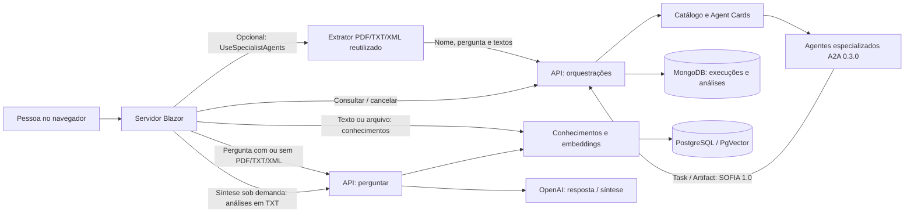

# Arquitetura atual da SOFIA — INFIS

Atualização: 2026-11-09. Estado consolidado após A2A, Blazor e integração RAG (003).
O [relatório inicial](../RELATORIO_ARQUITETURA_ATUAL_SOFIA.md) é uma baseline histórica.

## Solução e responsabilidades

| Projeto | Papel |
|---|---|
| SofiaInfis.Api | ASP.NET Core net10.0; perguntas, conhecimentos e módulo A2A opcional |
| SofiaInfis.Web | Blazor net10 Interactive Server; apresentação, chat e cliente da API |
| SofiaInfis.Api.Tests | Unidade, contratos, integração, regressão e testes do frontend |

O diagrama descreve fluxos reais configuráveis. Demonstração é uma implementação
separada no servidor Blazor e não realiza essas chamadas externas.

## Interface e cliente HTTP

Home apresenta a SOFIA e solicita nome. ChatPanel mantém a conversa e os anexos
transitórios; componentes específicos renderizam identidade, Markdown e rastreamento.
ISofiaChat separa a UI do gateway real ou demonstrativo. LiveSofiaChat usa RAG/OpenAI diretamente por padrão e, opcionalmente, acompanha
execuções e preserva resultados por agente, com DocumentPreparation antes do A2A.

O navegador usa o circuito Blazor; a API é chamada pelo servidor. A Web referencia
o projeto API para reutilizar DTOs e extrator, mas não inicia seu host. Não houve
extração de biblioteca de contratos nem duplicação do protocolo A2A no navegador.
JS cuida de arquivos, teclado, foco e scroll. CSS adapta o menu, os detalhes e o
compositor para telas menores. [Telas](INTERFACE_SOFIA.md).

## API e integrações preservadas

| Operação | Consumidor / uso |
|---|---|
| POST /api/v1/sofia/perguntar | Pergunta com ou sem anexos e síntese solicitada pela UI |
| POST /api/v1/conhecimentos/ingest | Ingestão textual pela API e tela /conhecimentos |
| POST /api/v1/conhecimentos/ingest/arquivo | PDF, TXT ou XML pela API e tela /conhecimentos |
| GET /health | Prontidão do esquema vetorial |
| POST /api/v1/conhecimentos/buscar | Busca semântica via API; também usada pelo serviço RAG |
| GET /api/v1/agentes | Catálogo filtrado por autorização |
| POST /api/v1/orquestracoes | Início durável da análise textual especializada |
| GET /api/v1/orquestracoes/{idExecucao} | Estado e chamadas paginadas |
| GET /api/v1/orquestracoes/{idExecucao}/chamadas/{idSolicitacao}/resultado | Análise original |
| POST /api/v1/orquestracoes/{idExecucao}/cancelar | Solicitação de cancelamento |

O endpoint de perguntas usa SofiaService, ExtracaoDocumentoService, ConhecimentoService,
EmbeddingService e clientes OpenAI. Ingestão divide texto em chunks de 1.200 com
sobreposição 200, gera embeddings 1.536 e grava transacionalmente em PostgreSQL.
A busca utiliza similaridade PgVector. O esquema vetorial é criado de forma idempotente com
`Rag:InitializeDatabase=true`, padrão do Compose. Dados existentes são preservados.
XML é validado com DTD proibido e sem resolver recursos externos.

A2A usa catálogo aprovado, descoberta de cards, adaptador JSON-RPC 2.0 de perfil
0.3.0, fila em memória, polling, validação de resultados, escrita Mongo e fechamento
com controle de versão. Não usa modelos wire v1 do SDK como se fossem0.3.0.
Pacotes Microsoft Agent Framework permanecem presentes, sem pipeline funcional
do framework. SQL Server continua sem consumo funcional identificado.

## Síntese e rastreabilidade

A 001 agrega estados e armazena análises; a 002 permite pedir uma síntese adicional
ao fluxo legado. A síntese possui outro idExecucao, seus tokens de chat e entrada
limitada a20.000 caracteres. Seu ID não substitui o ID original A2A.

O histórico A2A é durável no Mongo, com IDs, agentes, estados, resultados/falhas,
horários, duração e consumo quando disponível. Nome, pergunta e textos de entrada
não são campos persistidos nesse histórico por padrão. As análises podem conter
dados sensíveis e precisam de proteção e retenção no ambiente.

OpenTelemetry do módulo A2A registra atividades/métricas operacionais, sem payloads
documentais. A tela RunTrace apresenta etapas observadas pelo cliente, não todos
os spans do backend. Os endpoints consultados não expõem taskId/contextId remotos;
a interface não os inventa. Consumo ausente permanece não informado.

## Segurança, retenção e operação

- Nome é contexto, não autenticação. O frontend não implementa SSO ou contas.
- O token de serviço da Web permanece no servidor, por ambiente/User Secrets.
  Seu ClientId autoriza a integração perante a API; não identifica cada pessoa.
- Operações A2A exigem permissões e ownership por ClientId. As operações legadas
  preservam o acesso anterior, sem nova autenticação obrigatória nesta entrega.
- Sem URL pública de consulta de execução na UI. O estado exibido pertence ao
  circuito, mas isso não substitui isolamento autenticado por pessoa em produção.
- API de destino da Web exige HTTPS fora de loopback e não segue redirects.
  Comunicação backend-backend não requer ampliar CORS da API.
- Destinos dos agentes são aprovados por URL/IP, credenciais por referência e
  validação TLS padrão. Documentos não alteram catálogo ou permissões.
- Estado do chat é transitório, com até 20 mensagens; recarregar/Nova conversa não
  apaga análises duráveis. Mensagens anteriores não formam memória automática de LLM.
- Operação A2A inicial é instância única, 5 execuções ativas, 10 pendentes, 3 chamadas
  por execução. Prazo 120 s + fechamento 5 s; retenção 30 dias, TTL e limpeza explícita.
- Reinício encerra execuções abandonadas sem reenvio automático dos documentos.

## Implementado, parcial e ausente

| Capacidade | Estado atual |
|---|---|
| Apresentação, nome, chat e anexos PDF/TXT/XML | Implementada |
| Cliente A2A, estados e análises por agente | Implementada; agentes reais ainda não validados |
| Síntese final na UI | Implementada sob demanda; depende de RAG/OpenAI reais configurados |
| Rastreamento | Implementado por execução/etapas; não é painel completo de spans |
| RAG, ingestão e embeddings | Implementados na API e tela /conhecimentos |
| Histórico de execução | Implementado no Mongo, separado da conversa transitória |
| Autenticação | Efetiva nas rotas A2A; SSO do frontend ausente |
| Demonstração | Implementada, explícita e apenas em Development |
| Memória de LLM / histórico persistente do chat | Não implementados |
| OCR e administração visual do catálogo | Não implementados |
| Pipeline Microsoft Agent Framework / uso SQL Server | Não implementados funcionalmente |
| Deploy público e interoperabilidade com alunos | Não validados nesta etapa |

## Referências de verificação

[Spec001](../specs/001-integracao-a2a/spec.md),
[spec 002](../specs/002-interface-blazor/spec.md),
[guia Web](../SofiaInfis.Web/README.md),
[validação A2A](../specs/001-integracao-a2a/validation-results.md),
[validação Web](../SofiaInfis.Web/VALIDACAO.md),
[fixtures](../SofiaInfis.Api.Tests/Fixtures/README.md).
Validação integrada atual: [resultados 003](../specs/003-rag-integrado/validation-results.md),
incluindo OpenAI real, XML, alimentação da base e containers.

A stack Docker agora executa API, Blazor e os cinco serviços de infraestrutura.
`./scripts/Start-Sofia.ps1` constrói as imagens, fornece a credencial local via
ambiente e verifica HTTP 200 na interface e `/health`. O módulo A2A está desativado
nessa execução. A base existente contém referências reais; testes sintéticos de
ingestão são removidos após verificação. Ver [validação 003](../specs/003-rag-integrado/validation-results.md).
