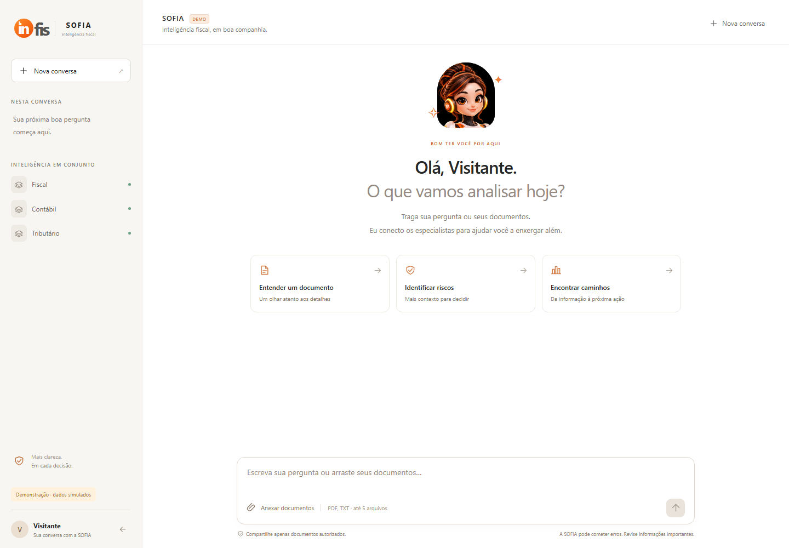
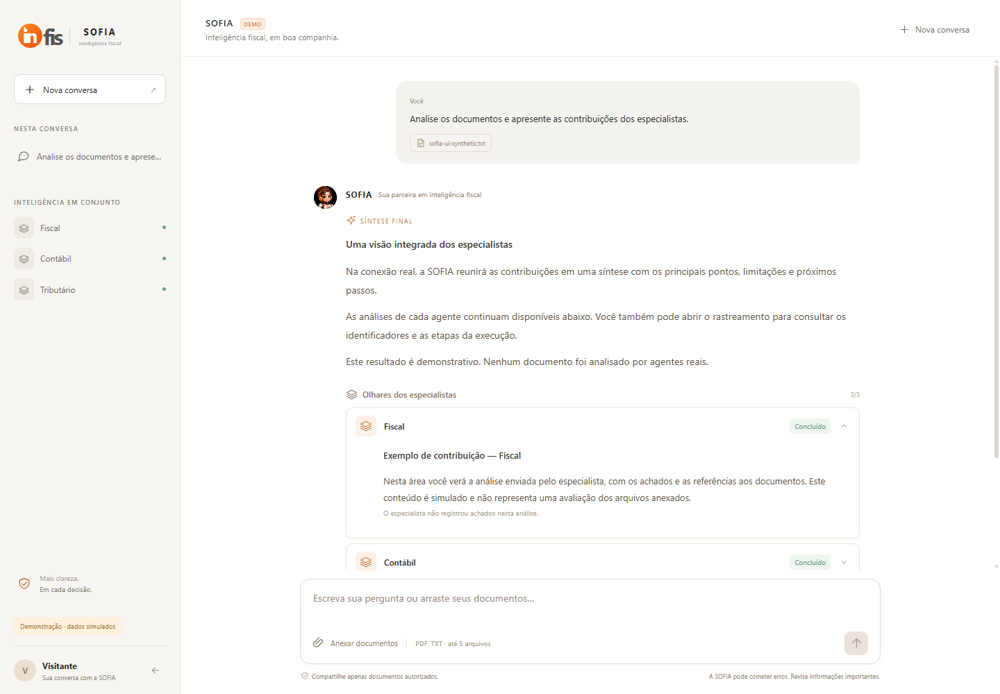
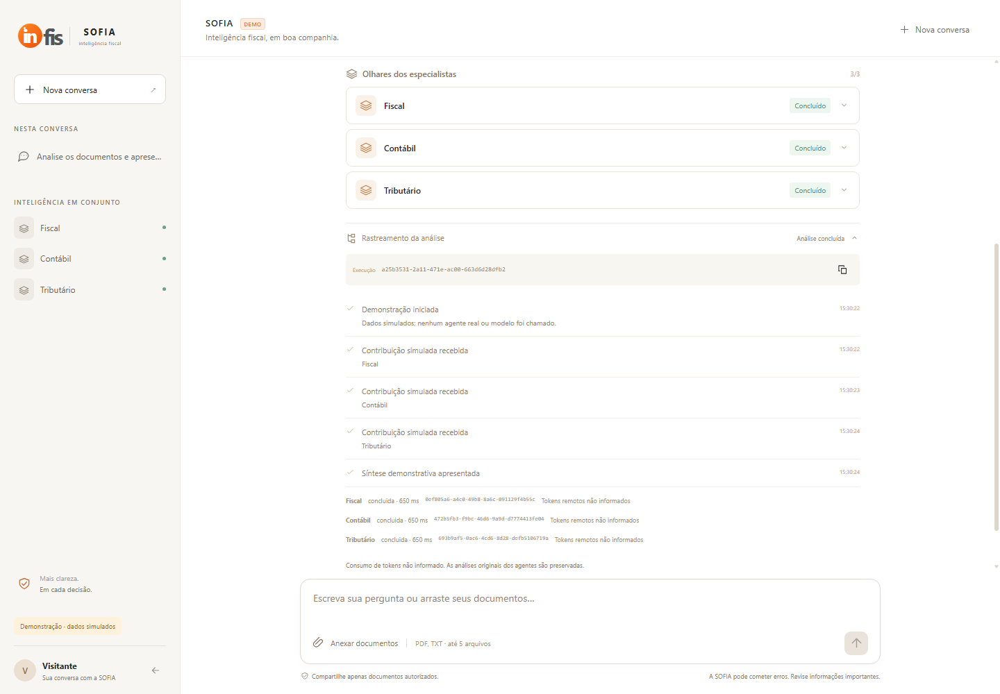
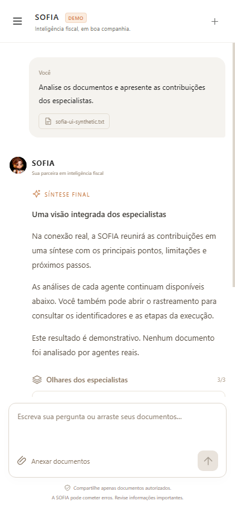

# Telas da SOFIA — interface Blazor

Capturas locais de 2026-11-05, utilizando o modo **DEMO**, nome genérico “Visitante”
e documento sintético. Não representam análise fiscal real. Os PNGs desta pasta
documental são cópias das capturas, disponibilizadas junto à documentação; os
artefatos originais em `artifacts/frontend` continuam locais e ignorados pelo Git.

## Apresentação

Identidade INFIS, personagem fornecida, proposta e entrada na conversa.

## Identificação

Nome de contexto antes da conversa; esta tela não é autenticação.

## Chat

Saudação, sugestões, compositor e especialistas disponíveis na demonstração.

## Análises e resultado final

Contribuições recolhíveis e síntese separada, apresentada após ação do usuário.

## Rastreamento

ID da execução, solicitações, etapas, estados, durações e consumo informado.

## Celular

Captura 390×844, com menu lateral recolhido e compositor acessível.

Especificação: [002 — Interface Blazor](../specs/002-interface-blazor/spec.md).
Operação: [quickstart](../specs/002-interface-blazor/quickstart.md).
