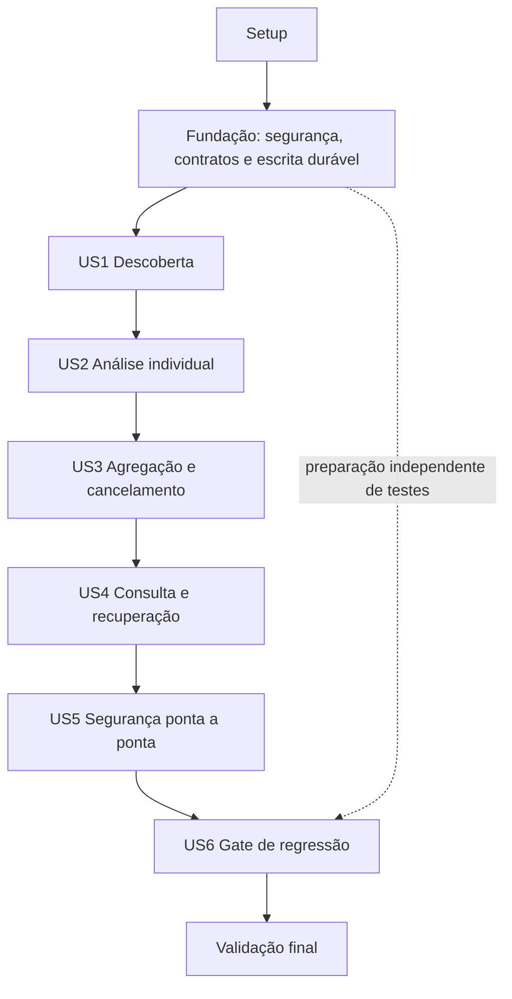

# Tasks: 001 — Integração A2A da SOFIA

**Input**: documentos em `specs/001-integracao-a2a/`.
**Prerequisites**: [plan.md](plan.md), [spec.md](spec.md), [research.md](research.md),
[data-model.md](data-model.md), [contratos](contracts/README.md) e [quickstart.md](quickstart.md).
**Governança**: [constituição](../../.specify/memory/constitution.md), skills
[contrato](../../.agents/skills/sofia-a2a-contrato/SKILL.md),
[implementação](../../.agents/skills/sofia-a2a-implementacao/SKILL.md) e
[HTTP/CORS](../../.agents/skills/sofia-cors-rest-a2a/SKILL.md).
**Created**: 2026-11-05.
**Tests**: obrigatórios por FR-027 e princípio X; tarefas abaixo incluem unitários,
contrato, integração e regressão. Nenhum teste/código foi executado ou implementado
por esta geração de tarefas.
**Organization**: setup → fundação → seis histórias na prioridade da spec → validação final.
Os 80 itens foram gerados inicialmente pendentes e depois concluídos na
implementação 001, conforme [validation-results.md](validation-results.md).
O frontend posterior está registrado na [especificação 002](../002-interface-blazor/spec.md).

## Format: `[ID] [P?] [Story] Description`

- IDs sequenciais e dependências explícitas são a ordem executável.
- [P] permite paralelismo somente quando todas as dependências listadas estão
  concluídas e não existe edição concorrente de arquivo compartilhado.
- [US1]–[US6] aparecem apenas nas fases de histórias.
- Testes de história são escritos antes da implementação correspondente.
  Confirmar falha de comportamento antes de completar a funcionalidade;
  falha de compilação, segredo ausente ou infraestrutura inválida não comprova teste vermelho.
- Nenhum checkbox deve ser marcado por mera geração de documento ou fixture.
  Marcar apenas após implementação e evidência verificável.
- Não fazer commits, publicar repositório, alterar pacotes produtivos ou migrar
  protocolo automaticamente por instrução genérica deste checklist.

## Path Conventions

Caminhos das tarefas são relativos à raiz da solução:
`SofiaInfis.Api/` para a API existente, `SofiaInfis.Api.Tests/` para o projeto
de testes planejado e `specs/001-integracao-a2a/` para contratos/evidências.
Arquivos citados ainda inexistentes são alvos da implementação, não dependências
que este comando deva criar agora. Validation-results e baseline serão produzidos
durante a execução das tarefas, sem dados sensíveis.

O domínio é SOFIA1.0; transporte é A2A0.3.0/JSON-RPC 2.0. O pacote restaurado usa
modelos v1; o adaptador próprio mantém o perfil da turma sem alterar dependências.
A API local de orquestração não deve ser anunciada como servidor A2A.

## Phase 1: Setup (Shared Infrastructure)

**Purpose**: Preparar baseline, projeto de testes e fixtures sem modificar o comportamento da aplicação.

- [X] T001 Registrar baseline dos três endpoints, DTOs, limites, dependências e estado real (sem memória conversacional funcional); distinguir A2A v1 restaurado do perfil 0.3.0. Não alterar pacotes de produção. Arquivos: `specs/001-integracao-a2a/validation-baseline.md`. Dependências: nenhuma.

- [X] T002 Criar projeto de testes net10.0 e adicioná-lo à solução, preservando o projeto atual; fixar xunit 2.9.3, xunit.runner.visualstudio 3.1.4, Microsoft.NET.Test.Sdk 17.14.1, Microsoft.AspNetCore.Mvc.Testing 10.0.9 e JsonSchema.Net 7.3.4 somente como dependências de teste. Arquivos: `SofiaInfis.Api.Tests/SofiaInfis.Api.Tests.csproj`, `SofiaInfis.slnx`. Dependências: T001.

- [X] T003 [P] Copiar schemas/exemplos planejados para fixtures, obter schema oficial do tag v0.3.0 com origem/hash registrados e manter dados inteiramente sintéticos; não editar contrato canônico nem skills. Arquivos: `SofiaInfis.Api.Tests/Fixtures/Contracts/`, `SofiaInfis.Api.Tests/Fixtures/Contracts/README.md`, `specs/001-integracao-a2a/contracts/`. Dependências: T002.

- [X] T004 [P] Preparar WebApplicationFactory com configuração isolada, segredos efêmeros e substitutos de OpenAI/PostgreSQL; não consumir tokens nem registrar credenciais. Arquivos: `SofiaInfis.Api.Tests/Fixtures/SofiaApiFactory.cs`. Dependências: T002.

- [X] T005 [P] Criar agentes HTTP determinísticos locais com card/RPC em caminhos distintos, contador de chamadas e respostas configuráveis (sucesso, working, erro e atraso), relógio de teste e fixture Mongo em banco exclusivo sem dados de produção. Arquivos: `SofiaInfis.Api.Tests/Fixtures/A2AAgentServer.cs`, `SofiaInfis.Api.Tests/Fixtures/ControlledTimeProvider.cs`, `SofiaInfis.Api.Tests/Fixtures/MongoFixture.cs`. Dependências: T002.

**Checkpoint**: projeto/fixtures isolados prontos e baseline documentado; não atualizar dependências produtivas.

---

## Phase 2: Foundational (Blocking Prerequisites)

**Purpose**: Entregar opções, contratos, persistência mínima de escrita, transporte seguro e autenticação reutilizáveis. Esta fase bloqueia as histórias.

Nenhuma história começa antes do checkpoint da fundação. Segurança mínima e gravação
anterior ao envio são fundação, não ficam adiadas até US5/US4.

- [X] T006 [P] Definir opções do módulo com "Enabled=false por padrão", "cinco execuções ativas e dez pendentes", "três chamadas ativas por execução", descoberta 5 s, chamada 60 s, execução 120 s, fechamento 5 s, polling 500 ms, envelope 1 MiB e retenção 30 dias; validar catálogo e clientes apenas no módulo, sem ValidateOnStart fatal global. Arquivos: `SofiaInfis.Api/Services/A2A/Configuration/A2AOptions.cs`, `SofiaInfis.Api/Services/A2A/Configuration/A2AOptionsValidator.cs`. Dependências: T003, T004, T005.

- [X] T007 [P] Criar records de entrada e domínio com nomes JSON explícitos: "versaoContrato=1.0; idExecucao/idSolicitacao UUID; usuario.nome não vazio"; "nome transitório, 1–200 caracteres; não autentica"; pergunta 5–2.000 caracteres; 1–5 documentos com "idDocumento único na execução, nome/texto não vazios; tipo MIME opcional; texto 1–20.000 caracteres; não é binário"; "contexto opcional"; capacidades não vazias e únicas. No corpo local, textoCompleto opcional default true; false impede envio; não transportar esse indicador como novo campo obrigatório do domínio. Arquivos: `SofiaInfis.Api/DTOs/A2A/CriarOrquestracaoRequest.cs`, `SofiaInfis.Api/DTOs/A2A/SolicitacaoAnaliseSofia.cs`, `SofiaInfis.Api/DTOs/A2A/DocumentoAnalise.cs`. Dependências: T003, T004, T005.

- [X] T008 [P] Criar records de resultado e achados: "agente.idAgente/nome", "analise não vazia; achados obrigatório"; status concluido/parcial/erro; "idAchado, descricao, idDocumentos e evidencias; referências válidas; severidade opcional baixa/media/alta/critica"; erro com "codigo e mensagem não sensíveis; obrigatório quando status=erro". Seguir schema/canônico: observacoes opcional como array; erro opcional/nulo fora de status erro; tolerar novos campos opcionais sem mudar nomes. Arquivos: `SofiaInfis.Api/DTOs/A2A/ResultadoAnaliseSofia.cs`, `SofiaInfis.Api/DTOs/A2A/AchadoAnalise.cs`, `SofiaInfis.Api/DTOs/A2A/ErroAnalise.cs`. Dependências: T003, T004, T005.

- [X] T009 Definir documentos Mongo de execução e chamada sem payload bruto: _id UUID em string, ownerClientId, ownerRunId, "version | Inteiro incrementado em CAS", IDs de capacidades/documentos/agentes e ordem; "criadoEm / iniciadoEm / encerradoEm | UTC, encerramento nullable enquanto aberto"; deadline e expiresAt. Execução: em_andamento/concluida/parcial/falhou/cancelada/interrompida. Chamada: aguardando/em_andamento/concluida/falhou/timeout/cancelada/interrompida; taskId/contextId/messageId/rpcIds distintos dos IDs de domínio; resultado/falhaTecnica nullable; consumo nullable, duração medida. Não gravar nome/pergunta/texto/token/card bruto. Arquivos: `SofiaInfis.Api/Services/A2A/Persistence/ExecutionDocument.cs`, `SofiaInfis.Api/Services/A2A/Persistence/AgentCallDocument.cs`, `SofiaInfis.Api/Services/A2A/Domain/ExecutionStates.cs`, `SofiaInfis.Api/Services/A2A/Persistence/ConsumoInformado.cs`. Dependências: T006, T007, T008.

- [X] T010 Definir assinaturas de IAgentRegistry, IAgentDiscovery, IA2AAgentClient, ISofiaAnalysisValidator, IExecutionRepository e IOrchestrationService com contratos de cancelamento, ownership, CAS e falhas tipadas; incluir descritores de agente e contexto de chamada necessários aos testes sem criar projetos de domínio separados. Arquivos: `SofiaInfis.Api/Services/A2A/Abstractions/`, `SofiaInfis.Api/Services/A2A/Domain/AgentDescriptor.cs`, `SofiaInfis.Api/Services/A2A/Domain/A2AFailure.cs`. Dependências: T009.

- [X] T011 [P] Escrever testes de esquema Bearer opaco, clientId estável na rotação, 401/403 e ausência de fallback global; verificar comportamento vermelho antes do handler, sem aceitar erro de infraestrutura como teste válido. Arquivos: `SofiaInfis.Api.Tests/Unit/ServiceAuthenticationTests.cs`. Dependências: T010.

- [X] T012 [P] Escrever testes Mongo de criação antes do envio, uma chamada por execução/agente, CAS/ownerRunId, write incerto e rejeição de upsert/troca de estado terminal; usar banco real de teste isolado. Arquivos: `SofiaInfis.Api.Tests/Integration/MongoExecutionWriteTests.cs`. Dependências: T010.

- [X] T013 [P] Escrever testes de clientes discovery/RPC separados, TLS, allowlist de origem/porta/caminho/rede e resolução/conexão, redirects bloqueados e não encaminhamento de token de entrada a agente; simular DNS sem alterar rede do computador. Arquivos: `SofiaInfis.Api.Tests/Unit/OutboundTransportPolicyTests.cs`. Dependências: T010.

- [X] T014 Implementar esquema SofiaA2AService e políticas explícitas a2a:agents:read/execute/read/cancel, token aleatório >=256 bits, hashes SHA-256 externos e comparação constante; clientId não deriva de usuario.nome. Não marcar controllers antigos com Authorize nem criar fallback global. Arquivos: `SofiaInfis.Api/Services/A2A/Security/SofiaA2AServiceHandler.cs`, `SofiaInfis.Api/Services/A2A/Security/A2AAuthorizationPolicies.cs`. Dependências: T011.

- [X] T015 Implementar IHttpClientFactory para discovery/RPC com destinos aprovados, validação de resolução/conexão, HTTP só em desenvolvimento isolado e HTTPS validado nos demais; desabilitar redirects e segredos em URL; resolver credentialRef por ambiente e nunca reutilizar Authorization entre destinos. Arquivos: `SofiaInfis.Api/Services/A2A/Security/AgentDestinationPolicy.cs`, `SofiaInfis.Api/Services/A2A/Security/AgentCredentialProvider.cs`, `SofiaInfis.Api/Services/A2A/Transport/A2AHttpClientFactory.cs`. Dependências: T013.

- [X] T016 Implementar gravações nas coleções a2a_execucoes/a2a_chamadas com w:1,j:true, timeout próprio, inserts identificados, CAS por versão/estado/ownerRunId, unique idExecucao/idAgente e limite BSON; reconhecer write só após acknowledgment e reler ID em resultado incerto; não presumir transação multidocumento. Arquivos: `SofiaInfis.Api/Services/A2A/Persistence/MongoExecutionRepository.cs`, `SofiaInfis.Api/Services/A2A/Persistence/MongoIndexInitializer.cs`. Dependências: T012.

- [X] T017 Registrar serviços/TimeProvider e proteção de disponibilidade de forma aditiva; opções inválidas, falha Mongo/índices ou Enabled=false degradam só módulo novo para 503, sem depender de segredos/DB/cards para iniciar o legado; workers não podem encerrar o host por essas falhas. Arquivos: `SofiaInfis.Api/Extensions/A2AConfigExtension.cs`, `SofiaInfis.Api/Services/A2A/Domain/A2AModuleAvailability.cs`, `SofiaInfis.Api/Services/A2A/Security/A2AEnabledResourceFilter.cs`, `SofiaInfis.Api/Program.cs`. Dependências: T014, T015, T016.

- [X] T018 Definir ProblemDetails somente para novos endpoints: codigo, traceId e idExecucao quando disponível; mapear 400/401/403/404/409/413/429/503, sem expor corpo, nome, segredo ou stack; preservar tratamento dos controllers atuais. Arquivos: `SofiaInfis.Api/Services/A2A/Domain/A2AProblemFactory.cs`. Dependências: T017.

- [X] T019 Executar build e testes da fundação; registrar resultado/pendências e comprovar startup legado com A2A desativada, sem Mongo/segredos novos. Só liberar histórias com contratos/DI compilando e testes aplicáveis verdes. Arquivos: `specs/001-integracao-a2a/validation-results.md`, `SofiaInfis.Api.Tests/SofiaInfis.Api.Tests.csproj`. Dependências: T018.

**Checkpoint**: T019 concluída; interfaces/DI compilam, dados mínimos são persistidos, transporte e auth têm testes aplicáveis verdes.

---

## Phase 3: User Story 1 — Identificar especialistas disponíveis (Priority: P1)

**Goal**: Descobrir e selecionar agentes autorizados com capacidades compatíveis.

**Independent Test**: Dois cards válidos e um inválido: conferir identidade/skills/destino, <=5 s por descoberta e nenhum envio a inelegível; seleção vazia encerra uma execução de fixture como falhou sem análise.

### Tests for User Story 1

- [X] T020 [P] [US1] Escrever testes de idAgente estável/único, enabled, cardUri, expectedName, allowedCapabilities e permissões; identidade duplicada é inválida, card não concede autorização e segredo não aparece na listagem. Arquivos: `SofiaInfis.Api.Tests/Unit/ConfiguredAgentRegistryTests.cs`. Dependências: T019.

- [X] T021 [P] [US1] Escrever testes HTTP para dois cards válidos e um inválido, timeout <=5 s, protocolo/transporte/modo incompatível, endereço RPC diferente do card e endpoint não aprovado; nenhum documento enviado ao inelegível. Arquivos: `SofiaInfis.Api.Tests/Integration/AgentDiscoveryTests.cs`. Dependências: T019.

- [X] T022 [P] [US1] Escrever teste do contrato GET /api/v1/agentes conforme OpenAPI, com lista sanitizada, elegivel/capacidades/motivo e política a2a:agents:read, sem credenciais. Arquivos: `SofiaInfis.Api.Tests/Contract/AgentsEndpointContractTests.cs`. Dependências: T019.

- [X] T023 [P] [US1] Escrever teste independente do desfecho sem agentes: preparar execução em_andamento no banco de teste, obter seleção vazia e registrar falhou com capacidades sem cobertura, sem disparar análise nem inventar resultado. Arquivos: `SofiaInfis.Api.Tests/Integration/NoEligibleAgentExecutionTests.cs`. Dependências: T019.

### Implementation for User Story 1

- [X] T024 [US1] Criar representação wire isolada do card 0.3 com protocolVersion, preferredTransport, name, version, url, skills/modos/security; exigir "protocolo 0.3.0, JSONRPC, suporte ao modo textual e skill identificada" e não inventar idAgente nativo. Arquivos: `SofiaInfis.Api/Services/A2A/Transport/AgentCard03.cs`, `SofiaInfis.Api/DTOs/A2A/AgenteDisponivel.cs`. Dependências: T020, T021, T022, T023.

- [X] T025 [US1] Implementar catálogo imutável validado e identificação esperada do agente usando opções; credentialRef/discoveryCredentialRef são apenas referências externas e não saem na projeção pública. Arquivos: `SofiaInfis.Api/Services/A2A/ConfiguredAgentRegistry.cs`. Dependências: T024.

- [X] T026 [US1] Implementar leitura/validação do card usando cliente seguro, limite de bytes em stream e prazo de descoberta, com inelegibilidade isolada por agente; tratar indisponibilidade sem falhar a API legada. Arquivos: `SofiaInfis.Api/Services/A2A/AgentDiscoveryService.cs`. Dependências: T025.

- [X] T027 [US1] Implementar seleção pela interseção de capacidades explícitas, skills e permissões: todos os elegíveis, no máximo uma chamada por agente, ordem estável e capacidades sem cobertura; não usar LLM para classificar pergunta. Arquivos: `SofiaInfis.Api/Services/A2A/Domain/AgentCapabilitySelector.cs`. Dependências: T026.

- [X] T028 [US1] Implementar registro terminal de nenhuma capacidade elegível, preservando idExecucao/proprietário/semCobertura e usando CAS do repositório; operação não envia documentos e será chamada pelo pipeline de aceitação da US2. Arquivos: `SofiaInfis.Api/Services/A2A/NoEligibleAgentExecutionRecorder.cs`. Dependências: T023, T027.

- [X] T029 [US1] Implementar GET /api/v1/agentes autenticado e sanitizado, ligando discovery e opções via DI; nenhuma análise deve ser disparada por descoberta. Arquivos: `SofiaInfis.Api/Controllers/AgentesController.cs`, `SofiaInfis.Api/Extensions/A2AConfigExtension.cs`. Dependências: T028.

- [X] T030 [US1] Executar US1.1–US1.4 e SC-001: cards/capacidades/prazos, ausência de envio a inválido e registro sem agente usando execução previamente criada na fixture. A chamada HTTP de início completa será integrada na US2. Arquivos: `specs/001-integracao-a2a/validation-results.md`. Dependências: T029.

**Checkpoint**: Descoberta utilizável e US1.1–US1.4 verificáveis sem chamar um modelo nem executar análise.

---

## Phase 4: User Story 2 — Obter análise de um especialista (Priority: P1)

**Goal**: Aceitar execução e obter resultado estruturado de um especialista com documentos textuais intactos.

**Independent Test**: Um agente determinístico, dois documentos e uma pergunta: POST202, exatamente uma análise enviada, acompanhamento de Task e resultado correlacionado salvo; testar sem achados e erro de negócio.

### Tests for User Story 2

- [X] T031 [P] [US2] Escrever testes de round-trip/schema do domínio, ausência/null/brancos, versão, UUID, status, enum de severidade, erro obrigatório em status erro e campos opcionais novos; incluir Unicode, documento duplicado, textoCompleto=false e limites da spec. Arquivos: `SofiaInfis.Api.Tests/Contract/SofiaDomainContractTests.cs`. Dependências: T019.

- [X] T032 [P] [US2] Escrever testes wire contra schema oficial 0.3: kind message/task/text, JSON interno no TextPart, rpc.id/Task/Context, exatamente result ou error e um Artifact analise-sofia-v1; não usar DTOs do SDK v1 nem aceitar Message final não pactuada. Arquivos: `SofiaInfis.Api.Tests/Contract/A2A03WireContractTests.cs`. Dependências: T019.

- [X] T033 [P] [US2] Escrever integração POST202→worker→registro com um agente e dois textos, sem achados e erro de negócio, working→tasks/get→completed; validar texto integral, IDs, nenhuma reanálise e nenhuma aceitação quando gravação/fila falha. Arquivos: `SofiaInfis.Api.Tests/Integration/SingleAgentAnalysisTests.cs`. Dependências: T030.

### Implementation for User Story 2

- [X] T034 [US2] Implementar validação da entrada local e domínio: "Caracteres do novo contrato são contados por escalares Unicode"; usuário 1–200, pergunta5–2.000, documentos1–5, texto1–20.000, IDs únicos/não vazios e textoCompleto false rejeitado; ler corpo <=1 MiB e verificar envelope externo serializado antes de delegar, sem truncar. Arquivos: `SofiaInfis.Api/Services/A2A/Domain/OrchestrationInputValidator.cs`. Dependências: T031.

- [X] T035 [US2] Implementar validação contextual de versão/execução/solicitação/agente e referências documentais; rejeitar propriedades JSON duplicadas, obrigatórios nulos/brancos, status desconhecido, achados ausente ou evidência inventada nas fixtures; análise sem achados válida não é erro. Veracidade factual não é inferida pelo schema. Arquivos: `SofiaInfis.Api/Services/A2A/Domain/SofiaAnalysisValidator.cs`. Dependências: T034.

- [X] T036 [US2] Implementar codec explícito de Message/Task/Artifact/erros JSON-RPC0.3, serializando SolicitacaoAnaliseSofia como texto JSON UTF-8 e preservando campos extras opcionais de domínio; separar IDs técnicos e de negócio e rejeitar artefato final ambíguo. Arquivos: `SofiaInfis.Api/Services/A2A/Transport/A2A03JsonCodec.cs`. Dependências: T032, T035.

- [X] T037 [US2] Implementar message/send e tasks/get no url aprovado do card, polling500 ms e prazo da chamada<=60 s incluindo polling; stream de resposta <=1 MiB inclusive após descompressão/sem Content-Length; não reenviar análise automaticamente e não usar status.message como conclusão. Arquivos: `SofiaInfis.Api/Services/A2A/Transport/JsonRpc03AgentClient.cs`. Dependências: T036, T015.

- [X] T038 [US2] Implementar reserva de capacidade e fila em memória (cinco ativos, dez pendentes), registrar início antes do envio e enfileirar antes de confirmar202; excesso429, falha de fila/registro503, payload transitório liberado ao terminar; desconexão após202 não cancela trabalho aceito. Arquivos: `SofiaInfis.Api/Services/A2A/Workers/OrchestrationQueue.cs`, `SofiaInfis.Api/Services/A2A/OrchestrationService.cs`. Dependências: T033, T034, T016.

- [X] T039 [US2] Implementar worker com escopo DI por execução e pipeline de uma chamada: discovery, idSolicitacao, registro aguardando antes do envio, análise validada e resultado original salvo; usar NoEligibleAgentExecutionRecorder quando nenhuma capacidade elegível, encerrando falhou com semCobertura, sem análise fictícia; preservar negócio erro separado de falha técnica. Arquivos: `SofiaInfis.Api/Services/A2A/Workers/OrchestrationWorker.cs`, `SofiaInfis.Api/Services/A2A/Domain/SingleAgentExecutionPipeline.cs`. Dependências: T037, T038, T027.

- [X] T040 [US2] Implementar POST /api/v1/orquestracoes protegido por a2a:execute, usuário/pergunta/documentos/capacidades no corpo, idExecucao gerado pela SOFIA e202 com Location relativo/registroConfirmado só após aceitação; ligar worker/serviços na extensão sem alterar endpoints antigos. Arquivos: `SofiaInfis.Api/Controllers/OrquestracoesController.cs`, `SofiaInfis.Api/DTOs/A2A/OrquestracaoAceita.cs`, `SofiaInfis.Api/Extensions/A2AConfigExtension.cs`. Dependências: T039.

- [X] T041 [US2] Executar US1.4, US2.1–US2.5, SC-002 e contratos; confirmar Task válida, dois documentos integrais e uma única análise. Consultar registro via fixture de repositório até a consulta HTTP da US4 existir; documentar esse limite do incremento. Arquivos: `specs/001-integracao-a2a/validation-results.md`. Dependências: T040.

**Checkpoint**: Primeiro caminho de análise funcional; registro pode ser inspecionado pela fixture até os GET da US4 estarem prontos.

---

## Phase 5: User Story 3 — Reunir respostas e preservar sucesso parcial (Priority: P1)

**Goal**: Executar múltiplos especialistas, preservar contribuições e encerrar corretamente sob falhas/cancelamento.

**Independent Test**: Três agentes, dois sucessos e um indisponível/lento: preservar duas análises, classificar parcial <=125 s e rejeitar respostas trocadas/duplicadas/tardias, inclusive sob cancelamento.

### Tests for User Story 3

- [X] T042 [P] [US3] Escrever testes de redução de estados: zero elegíveis/todos erros= falhou, dois sucessos+falha=parcial, negócios parcial/erro distintos, sem achados=sucesso e capacidade sem cobertura; preservar análises originais sem síntese. Arquivos: `SofiaInfis.Api.Tests/Unit/ExecutionResultReducerTests.cs`. Dependências: T019.

- [X] T043 [P] [US3] Escrever testes de corrida/CAS com resposta fora de ordem, duplicada/tardia, IDs/agente/documentos trocados, cancelamento durante write e timeout; estado terminal não pode ser reaberto nem resultado anterior substituído. Arquivos: `SofiaInfis.Api.Tests/Integration/ExecutionRaceTests.cs`. Dependências: T041.

- [X] T044 [P] [US3] Escrever integração com três agentes (dois concluindo, um falhando/lento), cobertura incompleta e todos falhando; comprovar duas contribuições preservadas e prazo<=125 s sem reenvio de análise. Arquivos: `SofiaInfis.Api.Tests/Integration/PartialOrchestrationTests.cs`. Dependências: T041.

### Implementation for User Story 3

- [X] T045 [US3] Implementar estado global: "concluida: >=1 chamada, todas com negócio concluido, nenhuma capacidade sem cobertura"; parcial com resultado utilizável concluido/parcial e limitação; falhou sem utilizável; "cancelada"/"interrompida" próprios. Não criar estado global timeout nem contar negócio erro como utilizável. Arquivos: `SofiaInfis.Api/Services/A2A/Domain/ExecutionResultReducer.cs`. Dependências: T042.

- [X] T046 [US3] Implementar gate por execução, ownerRunId/version/estado em updates e cancelamento local; impedir gravação tardia, aguardar writes já iniciados e preservar terminais. Orçamento120 s desde aceitação inclui fila/vagas/discovery; fechamento separado<=5 s usa token não vencido. Arquivos: `SofiaInfis.Api/Services/A2A/Workers/ExecutionCoordinator.cs`. Dependências: T043, T045.

- [X] T047 [US3] Generalizar worker para todos os agentes selecionados, máximo três chamadas ativas por execução, idSolicitacao distinto por agente e nenhuma duplicação; registrar aguardando antes do envio, marcar restantes timeout no prazo e agregar sem descartar contribuições. Arquivos: `SofiaInfis.Api/Services/A2A/Workers/OrchestrationWorker.cs`, `SofiaInfis.Api/Services/A2A/Domain/AgentExecutionPipeline.cs`. Dependências: T044, T046.

- [X] T048 [US3] Implementar tasks/cancel com params.id da Task conhecida, no endpoint aprovado, tentativa limitada pelo orçamento; task falha/canceled/rejected/input-required/auth-required e mensagem final não pactuada têm causas distintas, sem fingir interrupção remota garantida. Arquivos: `SofiaInfis.Api/Services/A2A/Transport/JsonRpc03AgentClient.cs`. Dependências: T047.

- [X] T049 [US3] Implementar POST /api/v1/orquestracoes/{idExecucao}/cancelar com a2a:cancel e owner; preservar terminal prévio e devolver200 só após estado salvo,503 se persistência falhar; cancelamento posterior é idempotente. Arquivos: `SofiaInfis.Api/Controllers/OrquestracoesController.cs`, `SofiaInfis.Api/Services/A2A/OrchestrationService.cs`, `SofiaInfis.Api/DTOs/A2A/OrquestracaoCancelada.cs`. Dependências: T048.

- [X] T050 [US3] Instrumentar ActivitySource/Meter SofiaInfis.A2A, correlação execução/solicitação/agente/task/context, duração/status/erro/timeout e métricas de cardinalidade limitada; "entrada/saída/total/custo nullable no registro técnico; não é campo nativo do domínio/A2A"; consumo ausente null, sem inventar preço/token remoto. Arquivos: `SofiaInfis.Api/Services/A2A/A2AObservability.cs`, `SofiaInfis.Api/Services/A2A/Persistence/ConsumoInformado.cs`. Dependências: T049.

- [X] T051 [US3] Executar US3.1–US3.5, SC-003–SC-005 com três fixtures, incluindo tempos reais em ao menos uma integração; inspecionar término imutável, classificação de falhas e sucesso parcial. Arquivos: `specs/001-integracao-a2a/validation-results.md`. Dependências: T050.

**Checkpoint**: Fan-out limitado, estados terminais imutáveis, cancelamento local e falhas parciais comprovados.

---

## Phase 6: User Story 4 — Consultar a execução para consolidação (Priority: P1)

**Goal**: Disponibilizar estado e análises originais persistidas com isolamento, recuperação e retenção.

**Independent Test**: Criar registros por fixture ou pelas histórias anteriores, reiniciar uma única instância e consultar mesmo ID/resultado sem nova análise; verificar owner, expiração e falha de gravação.

### Tests for User Story 4

- [X] T052 [P] [US4] Escrever testes dos dois GET de execução/resultado conforme OpenAPI: paginação default20/max100, cursor por owner/execução, resumos sem análises embutidas, resultado original de negócio inclusive erro e409 quando ainda indisponível; ID alheio/desconhecido/expirado404. Arquivos: `SofiaInfis.Api.Tests/Contract/ExecutionQueryContractTests.cs`. Dependências: T041.

- [X] T053 [P] [US4] Escrever testes Mongo/host real de consulta após reinício sem chamada remota nova; reinício em andamento marca interrompida sem reenvio; sucesso preservado se resumo falhar após write da chamada, com acknowledgment incerto relido por ID. Arquivos: `SofiaInfis.Api.Tests/Integration/ExecutionRestartTests.cs`. Dependências: T051.

- [X] T054 [P] [US4] Escrever testes de expiração lógica, TTL/limpeza física e privacidade do documento Mongo; retenção "30 dias após encerramento", exclusão<=24 h, nomes/pergunta/textos/tokens ausentes, análise original restrita; relógio fake não substitui relógio do servidor Mongo. Arquivos: `SofiaInfis.Api.Tests/Integration/ExecutionRetentionTests.cs`. Dependências: T041.

### Implementation for User Story 4

- [X] T055 [US4] Criar projeções de consulta com IDs/estado/horários/capacidades/resumo e página de chamadas, links relativos para cada resultado; "Lista de chamadas é paginada por cursor opaco com ordenação estável, vinculada ao owner/idExecucao"; não incluir nome/pergunta/texto/card/credencial. Arquivos: `SofiaInfis.Api/DTOs/A2A/ExecucaoConsulta.cs`, `SofiaInfis.Api/DTOs/A2A/ChamadaResumo.cs`, `SofiaInfis.Api/DTOs/A2A/PaginaChamadas.cs`. Dependências: T052.

- [X] T056 [US4] Implementar queries Mongo filtradas por ownerClientId e "expiresAt > now", paginação estável idExecucao/ordem/_id e leitura separada do ResultadoAnaliseSofia; retorno alheio/expirado/inexistente indistinguível, sem qualquer nova análise. Arquivos: `SofiaInfis.Api/Services/A2A/Persistence/MongoExecutionRepository.cs`, `SofiaInfis.Api/Services/A2A/Security/ExecutionCursorProtector.cs`. Dependências: T055.

- [X] T057 [US4] Implementar GET /api/v1/orquestracoes/{idExecucao} e GET /api/v1/orquestracoes/{idExecucao}/chamadas/{idSolicitacao}/resultado com a2a:read/owner,400 cursor inválido,404 identidade/expiração e409 resultado indisponível; não converter falha técnica em domínio fictício. Arquivos: `SofiaInfis.Api/Controllers/OrquestracoesController.cs`, `SofiaInfis.Api/Services/A2A/OrchestrationService.cs`. Dependências: T056.

- [X] T058 [US4] Implementar reconciliação de instância única sem sobreposição: chamadas abertas do ownerRunId anterior viram interrompidas, terminais são preservadas e execução encerra interrompida; recompor resumo das chamadas sem recuperar payload/reanalisar; falha de reconciliação degrada só A2A. Arquivos: `SofiaInfis.Api/Services/A2A/Workers/ExecutionRecoveryWorker.cs`. Dependências: T053, T057.

- [X] T059 [US4] Completar índices _id único, ownerClientId/criadoEm/_id, estado/ownerRunId, idExecucao/idAgente único, idExecucao/ordem/_id e "TTL single-field expiresAt (expireAfterSeconds=0)"; aplicar mesma expiração às chamadas/execução após encerramento, prazo provisório conservador e rotina de limpeza com alerta para atraso>24 h. Arquivos: `SofiaInfis.Api/Services/A2A/Persistence/MongoIndexInitializer.cs`, `SofiaInfis.Api/Services/A2A/Workers/ExecutionRetentionWorker.cs`. Dependências: T054, T058.

- [X] T060 [US4] Completar protocolo de fechamento entre coleções: gate bloqueia novas gravações, aguarda existentes, usa encerradoEm comum, atualiza expiresAt dos filhos antes da execução e confirma terminal só após acknowledgment; não presumir transação/rollback e não declarar salvo após falha. Arquivos: `SofiaInfis.Api/Services/A2A/Persistence/MongoExecutionRepository.cs`, `SofiaInfis.Api/Services/A2A/Workers/ExecutionCoordinator.cs`. Dependências: T059.

- [X] T061 [US4] Executar US4.1–US4.6 e SC-006: reinício, concorrência de consulta/cancelamento, falha pré/pós-gravação e retenção; comprovar análises recuperáveis sem nova cobrança/reenvio e acesso só por proprietário. Arquivos: `specs/001-integracao-a2a/validation-results.md`. Dependências: T060.

**Checkpoint**: Consulta/resultado, recuperação de interrupções e retenção verificáveis; nenhuma retomada automática de documentos.

---

## Phase 7: User Story 5 — Proteger a comunicação e os documentos (Priority: P1)

**Goal**: Concluir verificação de segurança, confidencialidade, capacidades permitidas e CORS condicional.

**Independent Test**: Executar credenciais válidas/ausentes/sem permissão, outro owner, destinos bloqueados e documento adversarial; backend sem Origin funciona, logs não contêm sentinelas sensíveis.

### Tests for User Story 5

- [X] T062 [P] [US5] Escrever testes HTTP das cinco rotas para token ausente/inválido401, clientId válido sem permissão403, owner errado404, rotação mantendo acesso e capacidades não autorizadas sem envio; token do usuário nunca é credencial do agente. Arquivos: `SofiaInfis.Api.Tests/Integration/A2ASecurityBoundaryTests.cs`. Dependências: T061.

- [X] T063 [P] [US5] Escrever inspeção de logs/spans/métricas/ProblemDetails com sentinelas para nome/texto/análise/token, conteúdo adversarial tentando nova delegação e consumo ausente; nenhum vazamento, nenhuma delegação não autorizada e consumo null. Arquivos: `SofiaInfis.Api.Tests/Integration/A2APrivacyTests.cs`. Dependências: T051.

- [X] T064 [P] [US5] Escrever testes de chamada backend sem Origin e de política browser opcional: origem permitida recebe ACAO correspondente, desconhecida não, Vary quando aplicável e nenhuma combinação wildcard+credenciais; CORS não substitui401/403. Arquivos: `SofiaInfis.Api.Tests/Integration/A2AHttpCorsTests.cs`. Dependências: T061.

### Implementation for User Story 5

- [X] T065 [US5] Completar verificação de permissões/capacidades e ownership em cada operação e rotação de segredos sem mudar clientId; conferir resolução de credenciais separadas por destino e rejeitar esquema remoto incompatível com autenticação configurada. Arquivos: `SofiaInfis.Api/Services/A2A/Security/A2AAuthorizationPolicies.cs`, `SofiaInfis.Api/Services/A2A/Security/AgentCredentialProvider.cs`, `SofiaInfis.Api/Services/A2A/Domain/AgentCapabilitySelector.cs`. Dependências: T062.

- [X] T066 [US5] Centralizar sanitização de logs/spans/erros e propagação traceId/request IDs sem conteúdo pessoal, texto ou Authorization; desabilitar captura de payloads do módulo e preservar análises originais apenas no armazenamento protegido. Arquivos: `SofiaInfis.Api/Services/A2A/Security/A2ATelemetrySanitizer.cs`, `SofiaInfis.Api/Services/A2A/A2AObservability.cs`, `SofiaInfis.Api/Services/A2A/Domain/A2AProblemFactory.cs`. Dependências: T063, T065.

- [X] T067 [US5] Configurar SofiaBrowser somente nas novas rotas se houver origens explícitas por ambiente; GET/POST/OPTIONS, Content-Type/Authorization, sem cookies/AllowCredentials ou origem wildcard; sem frontend/origens, manter backend funcional e não exigir CORS para startup. Arquivos: `SofiaInfis.Api/Extensions/A2AConfigExtension.cs`, `SofiaInfis.Api/Services/A2A/Configuration/A2AOptions.cs`. Dependências: T064, T066.

- [X] T068 [US5] Executar US5.1–US5.4 e SC-008 a partir da rede das fixtures, incluindo TLS/destino bloqueado e adversarial; registrar evidências sanitizadas e limitações. Não publicar ou abrir firewall para realizar teste. Arquivos: `specs/001-integracao-a2a/validation-results.md`. Dependências: T067.

**Checkpoint**: Segurança de base já existente na fundação e histórias anteriores está verificada de ponta a ponta; não há etapa anterior autorizada a enviar dados reais sem proteção.

---

## Phase 8: User Story 6 — Continuar usando as funcionalidades atuais (Priority: P2)

**Goal**: Demonstrar preservação dos consumidores, serviços, contratos e integrações atuais.

**Independent Test**: Comparar baseline de perguntar (sem/com anexos), ingest e buscar com A2A desligada, sem agentes e com Mongo novo indisponível; mesmos campos/limites, sem novo nome/token obrigatório.

### Tests for User Story 6

- [X] T069 [P] [US6] Escrever testes de snapshots OpenAPI/JSON dos três endpoints existentes e DTOs, pergunta sem nome/anexos e ingestão/busca; registrar campos/defaults/status originais sem impor contrato novo. Arquivos: `SofiaInfis.Api.Tests/Regression/LegacyApiContractTests.cs`. Dependências: T019.

- [X] T070 [P] [US6] Escrever regressão de PDF/TXT e limites atuais: máximo5 arquivos,5 MiB por arquivo,20 MiB por requisição, truncamento sinalizado20.000 caracteres; preservar validações e comportamento já observado, sem transformar novo limite A2A em mudança legada. Arquivos: `SofiaInfis.Api.Tests/Regression/LegacyDocumentExtractionTests.cs`. Dependências: T019.

- [X] T071 [P] [US6] Escrever regressão de RAG/embeddings/ingestão transacional e metadados idExecucao/tokens/duração; doubles de clientes externos evitam tokens reais e não alteram os serviços produtivos. Arquivos: `SofiaInfis.Api.Tests/Regression/LegacyRagFlowTests.cs`. Dependências: T019.

- [X] T072 [P] [US6] Escrever regressão de startup/fluxos antigos com A2A off, agentes ausentes/lentos, Mongo indisponível e configuração nova inválida; nenhum host encerrado ou novo campo/segredo obrigatório nos endpoints antigos. Arquivos: `SofiaInfis.Api.Tests/Regression/A2AModuleIsolationTests.cs`. Dependências: T019.

### Implementation for User Story 6

- [X] T073 [US6] Completar isolamento de falhas/DI e workers sem alterar services/controllers/DTOs atuais: infraestrutura A2A é lazy quando off; falha de opção/índice/Mongo retorna503 só no módulo e não encerra host; manter registros/ordem funcional legados. Arquivos: `SofiaInfis.Api/Extensions/A2AConfigExtension.cs`, `SofiaInfis.Api/Services/A2A/Domain/A2AModuleAvailability.cs`, `SofiaInfis.Api/Services/A2A/Workers/OrchestrationWorker.cs`, `SofiaInfis.Api/Program.cs`. Dependências: T072, T068.

- [X] T074 [US6] Executar US6.1–US6.3 e SC-007; comparar baseline/snapshots e diffs de código, configuração e referências. Corrigir apenas regressões introduzidas pelo módulo; mudança de função antiga exige justificativa/aprovação antes de prosseguir. Arquivos: `specs/001-integracao-a2a/validation-results.md`. Dependências: T069, T070, T071, T073.

**Checkpoint**: Regressão concluída; nenhuma funcionalidade antiga alterada sem justificativa/aprovação.

---

## Phase 9: Polish & Cross-Cutting Concerns

**Purpose**: Validar escala prevista, compatibilidade, documentação e conformidade antes da entrega.

- [X] T075 Executar SC-009 com cinco execuções, três agentes e dois documentos de1.000 caracteres cada, incluindo fila/deadline e teto de três chamadas por execução; registrar correlação, latências e preservação dos resultados sem broadening não autorizado. Arquivos: `SofiaInfis.Api.Tests/Integration/OrchestrationConcurrencyTests.cs`, `specs/001-integracao-a2a/validation-results.md`. Dependências: T074.

- [X] T076 Executar matriz de compatibilidade: schemas, round-trip, campos adicionais opcionais, versão/protocolo incorretos, resultado parcial/erro, retorno assíncrono, limites e bytes escapados; garantir que não houve migração da turma a v1 ou uso de DTOs v1 como0.3. Arquivos: `SofiaInfis.Api.Tests/Contract/A2ACompatibilityMatrixTests.cs`, `specs/001-integracao-a2a/validation-results.md`. Dependências: T075.

- [X] T077 [P] Documentar opções A2A desativadas e configuração de teste sem segredos em exemplo separado; explicar clientId/permissões/hash, destinos, DNS/TLS, índices/TTL, instância única e limites; preservar appsettings/Compose locais e não criar serviço produtivo de aluno. Arquivos: `SofiaInfis.Api/appsettings.a2a.example.json`, `SofiaInfis.Api.Tests/Fixtures/README.md`. Dependências: T074.

- [X] T078 Atualizar README e quickstart com comandos reais após implementação, cinco rotas novas, contratos canônicos e credenciais externas; distinguir histórico de execução de memória conversacional e domínio1.0 de protocolo0.3.0. Arquivos: `README.md`, `specs/001-integracao-a2a/quickstart.md`. Dependências: T077.

- [X] T079 Executar restore/build/test da solução e roteiro quickstart; registrar cenários, tempos, payloads sintéticos, logs sanitizados e verificações não executadas. Serviços reais/alunos e tokens OpenAI não são pré-requisito do aceite automatizado. Arquivos: `specs/001-integracao-a2a/validation-results.md`, `SofiaInfis.Api.Tests/SofiaInfis.Api.Tests.csproj`. Dependências: T076, T078.

- [X] T080 Revisar cobertura FR-001–FR-027/SC-001–SC-009 e os12 princípios, conferir nenhum segredo versionado e nenhuma mudança antiga sem aprovação; registrar limitações de instância única/TTL/consumo e atualizar status somente com evidência real. Arquivos: `specs/001-integracao-a2a/validation-results.md`, `specs/001-integracao-a2a/tasks.md`. Dependências: T079.

---

## Dependencies & Execution Order

### Phase Dependencies

- Setup: T001 → T002 → T003/T004/T005.
- Fundação: contratos/opções → interfaces → testes → auth/HTTP/Mongo → composição/erros → T019.
- US1 conclui em T030; US2 depende de US1 para o pipeline real.
- US3 depende do caminho de análise US2 e conclui em T051.
- US4 usa resultados/regras de US3 para fechamento/reinício e conclui em T061.
- US5 verifica todo o caminho de acesso/envio/consulta após US4 e conclui em T068.
- US6 pode preparar testes depois da fundação; seu checkpoint T074
  exige as integrações concluídas e verificadas para comparar comportamento.
- Validação final só conclui após compatibilidade, documentação e suíte completa.

### User Story Dependencies

As histórias são fatias verificáveis por fixtures após a fundação, não sistemas
independentes sem infraestrutura. Testes unitários/contratuais podem ser preparados
antes da integração sequencial, conforme dependências de cada item.
O desfecho sem agentes é testado no recorder da US1 e reintegrado ao POST na US2.
Consulta pública de resultados só está completa com US4; não declarar US2 como
entrega final de consolidação.

### Within Each User Story

Testes → modelos/projeções → regras/serviços → endpoints → integração e evidência.
As tarefas de verificação reutilizam suíte relevante; não executar novamente
testes amplos sem mudança/falha que justifique, exceto a validação final requerida.
Não marcar sucesso de pipeline só porque o schema das fixtures passou.

### Parallel Opportunities

Há 30 tarefas [P] em arquivos distintos.
A marcação não autoriza iniciar antes das dependências nem supõe agentes paralelos
executando nesta geração. Modificações em Program.cs, extensão de DI, controllers,
repository, coordinator e validation-results.md são serializadas por dependência.
Projeto/solution/dependências de teste são tratados primeiro, antes de abrir frentes.

## Parallel Example: User Story 1

Após T019, preparar T020, T021,
T022 e T023 em arquivos de teste diferentes.
Implementação de card/registry/discovery segue depois, em ordem.

## Parallel Example: User Story 2

Após fundação, T031 e T032 são independentes.
Após T030, T033 pode ser preparado em terceiro
arquivo; a execução ponta a ponta aguarda adapter/worker/POST.

## Parallel Example: User Story 3

Após T041, preparar T043 e T044 em paralelo;
T042 usa apenas dados de domínio. Gate/coordinator/worker são
integrados sequencialmente para evitar corrida de edição.

## Parallel Example: User Story 4

Após T051, T052, T053 e
T054 usam arquivos distintos e bancos de teste separados.
A implementação dos GET/reconciliação/TTL mantém dependências explícitas.

## Parallel Example: User Story 5

Após T061, preparar T062, T063 e
T064 em paralelo. Sanitização/políticas/configuração compartilham
componentes e são concluídas em sequência.

## Parallel Example: User Story 6

Após T019, T069, T070,
T071 e T072 podem ser escritos em paralelo.
A prova final de preservação aguarda T073 e o módulo completo.

## Implementation Strategy

### MVP First (User Story 1)

Concluir setup, fundação e US1 (T001–T030):
descoberta autenticada e seleção de especialistas, sem análise real.
Validar cards/capacidades e registro sem agente com fixtures sintéticas.
Esse é MVP de descoberta, não integração completa com resultados consultáveis.

### Incremental Delivery

1. US2 adiciona análise individual textual e registro, com observação por fixture.
2. US3 acrescenta múltiplos agentes, falhas parciais, cancelamento e métricas.
3. US4 torna execuções/resultados consultáveis e recuperáveis, com retenção.
4. US5 fecha a verificação de segurança, privacidade e HTTP/CORS condicional.
5. US6 comprova preservação dos consumidores atuais.
6. Validação final comprova escala, compatibilidade, comandos e conformidade.

Nenhum incremento permite envio de documentos reais sem autenticação, destinos
aprovados e logs protegidos. O mínimo de integração demonstrável é US1+US2;
a entrega completa da Especificação001 exige todas as histórias e os gates finais.

### Traceability

| Requisitos / critérios | Tarefas principais |
|---|---|
| FR-001–FR-003 / SC-001 | T020–T030, T039 |
| FR-004 / US4.4, US5.1 | T014, T057, T062–T065 |
| FR-005–FR-010 / SC-002 | T007–T008, T031–T036, T039 |
| FR-011–FR-013 / SC-003 | T032, T035–T037, T043, T048 |
| FR-014–FR-017 / SC-004–SC-005 | T042–T049 |
| FR-018–FR-020 / SC-006 | T016, T038, T052–T061 |
| FR-021 / US5.4 | T050, T063, T066 |
| FR-022 | T009, T054, T059, T060 |
| FR-023–FR-024 / SC-008 | T013–T015, T062–T068 |
| FR-025 / SC-007 | T069–T074 |
| FR-026 | T031, T032, T076 |
| FR-027 / SC-009 | testes em cada história, T075, T079–T080 |

## Notes

- Total: 80 tarefas; setup5, fundação14, US1=11, US2=11, US3=10, US4=10,
  US5=7, US6=6, validação final6.
- Nenhuma branch foi criada: main continua sendo a branch real; 001-integracao-a2a
  é o contexto de feature resolvido pelo Spec Kit.
- Não criar servidor A2A produtivo da SOFIA nem todos os projetos dos alunos.
  Servidores determinísticos citados são somente fixtures de interoperabilidade.
- Não inferir autenticação JWT existente, memória conversacional funcional ou
  compatibilidade wire pelo simples fato de um pacote estar instalado.
- Em ambiguidades descritivas do data-model, prevalecem contrato canônico e
  schema: observacoes é array opcional, não null; erro é opcional/nulo exceto
  quando status=erro. Não ampliar nulabilidade nem alterar contrato na implementação.
- Operação inicial é instância única sem processos sobrepostos. Multinstância
  exigiria novo desenho de lease/fencing e não está autorizada por estas tarefas.
- Testes devem ser comportamentais, com HTTP e Mongo reais de teste onde necessário;
  não confundir testes de schema com prova de segurança semântica da análise.
- Não repetir envio de análise automaticamente após write incerto, timeout ou reinício.
- Atualizar checkboxes somente durante a implementação; este arquivo não registra
  conclusão de trabalho que ainda não foi executado.
